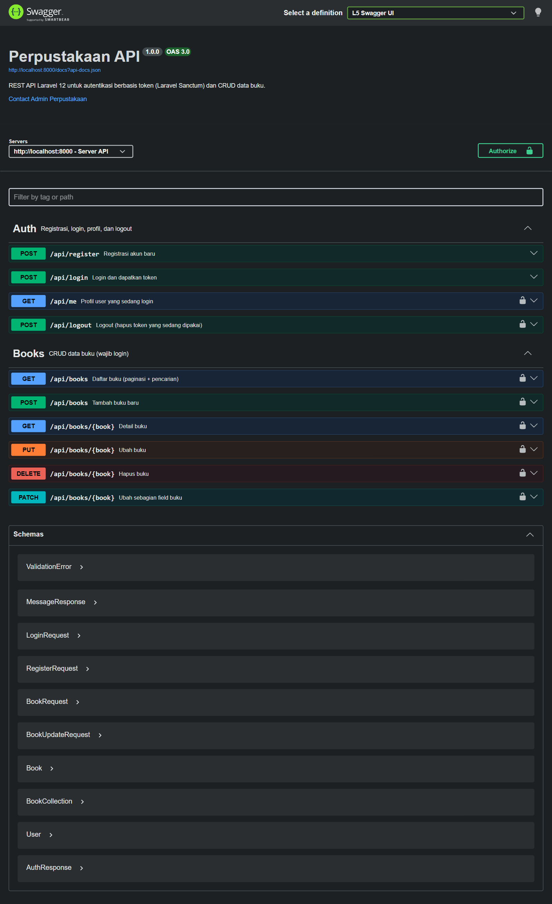

# Perpustakaan API — Laravel 12 REST API + Sanctum + OpenAPI (Swagger)

Hasil praktikum **Pemrograman Web Lanjut — Sesi #11**: REST API untuk login berbasis token (Laravel Sanctum),
CRUD data buku, dan dokumentasi interaktif OpenAPI 3 menggunakan **L5-Swagger** dengan PHP Attributes `#[OA\...]`.

| | |
|---|---|
| Nama | Ahmad Mofidur Robbiyal Aqla |
| NIM | 2495114006 |
| Mata Kuliah | Pemrograman Web Lanjut |



## Stack

- Laravel 12, PHP 8.4 (minimal 8.2)
- Laravel Sanctum 4 — token API (`php artisan install:api`)
- darkaonline/l5-swagger 11 (zircote/swagger-php) — Swagger UI + generator OpenAPI
- MySQL 8 (Laragon); pengujian otomatis memakai SQLite in-memory

## Daftar Endpoint

| Method | Endpoint | Fungsi | Login? |
|---|---|---|---|
| POST | `/api/register` | Daftar akun, dapat token | Tidak |
| POST | `/api/login` | Login, dapat token (maks. 6 percobaan/menit) | Tidak |
| GET | `/api/me` | Profil user yang login | Ya |
| POST | `/api/logout` | Hapus token yang sedang dipakai | Ya |
| GET | `/api/books` | Daftar buku (paginasi `page`, `per_page` + pencarian `search`) | Ya |
| POST | `/api/books` | Tambah buku | Ya |
| GET | `/api/books/{book}` | Detail buku | Ya |
| PUT/PATCH | `/api/books/{book}` | Ubah buku (PATCH boleh sebagian field) | Ya |
| DELETE | `/api/books/{book}` | Hapus buku | Ya |

Dokumentasi: **http://localhost:8000/api/documentation** (Swagger UI) dan **http://localhost:8000/docs** (JSON OpenAPI,
bisa diimpor ke Postman).

## Instalasi

```bash
git clone https://github.com/RequimeOfficial/<repo-ini>.git perpus-api
cd perpus-api
composer install
cp .env.example .env
php artisan key:generate
```

Buat database MySQL `perpus_api` (atau ubah `DB_CONNECTION=sqlite` di `.env`), lalu:

```bash
php artisan migrate:fresh --seed
php artisan l5-swagger:generate
php artisan serve
```

Konfigurasi penting di `.env`:

```env
APP_URL=http://localhost:8000
DB_CONNECTION=mysql
DB_DATABASE=perpus_api
L5_SWAGGER_CONST_HOST=http://localhost:8000   # URL server di Swagger UI
L5_SWAGGER_GENERATE_ALWAYS=true               # dokumentasi diperbarui otomatis saat development
L5_SWAGGER_UI_DOC_EXPANSION=list              # semua endpoint langsung tampil
L5_SWAGGER_UI_PERSIST_AUTHORIZATION=true      # token Authorize tidak hilang saat halaman di-refresh
```

**Akun demo (seeder):** `admin@example.com` / `password` — beserta 20 buku (5 buku nyata, mis. *Laskar Pelangi*,
dan 15 buku dari factory).

## Struktur Kode

```
app/Http/Controllers/Controller.php           # #[OA\Info], #[OA\Server], #[OA\SecurityScheme] (Bearer), #[OA\Tag], schema umum
app/Http/Controllers/Api/AuthController.php   # register, login, me, logout + atribut operasi
app/Http/Controllers/Api/BookController.php   # index, store, show, update, destroy + atribut operasi
app/Http/Requests/Auth/RegisterRequest.php    # validasi + #[OA\Schema] RegisterRequest
app/Http/Requests/Auth/LoginRequest.php       # validasi + #[OA\Schema] LoginRequest
app/Http/Requests/StoreBookRequest.php        # validasi tambah buku + schema BookRequest
app/Http/Requests/UpdateBookRequest.php       # validasi 'sometimes' (PATCH sebagian) + schema BookUpdateRequest
app/Http/Resources/UserResource.php           # format JSON user + schema User & AuthResponse
app/Http/Resources/BookResource.php           # format JSON buku + schema Book & BookCollection
app/Http/Middleware/ForceJsonResponse.php     # semua /api/* selalu membalas JSON
app/Models/Book.php, app/Models/User.php      # User memakai trait HasApiTokens
bootstrap/app.php                             # routing api, middleware JSON, pesan 404 JSON
config/l5-swagger.php, config/sanctum.php
database/migrations/..._create_books_table.php
database/factories/BookFactory.php
database/seeders/DatabaseSeeder.php, BookSeeder.php
routes/api.php
storage/api-docs/api-docs.json                # hasil php artisan l5-swagger:generate
tests/Feature/AuthApiTest.php, BookApiTest.php, SwaggerDocsTest.php
```

## Alur Autentikasi Token (Sanctum)

1. `POST /api/login` → `LoginRequest` memvalidasi input → user dicari berdasarkan email → `Hash::check` password.
   Salah → **422** `"Email atau password salah."`; benar → `$user->createToken()` menyimpan hash token di tabel
   `personal_access_tokens` dan mengembalikan `plainTextToken` (mis. `1|Xz9a...`).
2. Klien mengirim token di header `Authorization: Bearer <token>` pada setiap request.
3. Middleware `auth:sanctum` mencocokkan token dengan tabel `personal_access_tokens`; jika tidak ada/tidak valid → **401**.
4. `POST /api/logout` menghapus **hanya** token yang sedang dipakai (`currentAccessToken()->delete()`), sehingga
   token itu langsung tidak berlaku, sementara token di perangkat lain tetap aktif.

## Uji Coba lewat Swagger UI

Langkah: buka `/api/documentation` → **POST /api/login** (Try it out → Execute) → salin `token` → tombol
**Authorize** → tempel token (tanpa kata "Bearer") → coba endpoint Books → **POST /api/logout** → ulangi
GET /api/books.

| No | Langkah | Hasil | Bukti |
|---|---|---|---|
| 1 | Halaman Swagger UI | 10 operasi, 2 tag, 10 schema | [01_swagger_ui.png](screenshots/01_swagger_ui.png) |
| 2 | `POST /api/login` admin@example.com / password | **200**, token Bearer | [02_login_200.png](screenshots/02_login_200.png) |
| 3 | Authorize token | Gembok terkunci | [03_authorize_token.png](screenshots/03_authorize_token.png) |
| 4 | `GET /api/me` | **200**, profil admin | [04_me_200.png](screenshots/04_me_200.png) |
| 5 | `GET /api/books?search=hirata` | **200**, 2 buku Andrea Hirata | [05_books_index_200.png](screenshots/05_books_index_200.png) |
| 6 | `POST /api/books` | **201**, buku baru | [06_books_store_201.png](screenshots/06_books_store_201.png) |
| 7 | `POST /api/books` ISBN sama | **422**, `isbn has already been taken` | [07_books_store_422_isbn.png](screenshots/07_books_store_422_isbn.png) |
| 8 | `GET /api/books/{book}` | **200** | [08_books_show_200.png](screenshots/08_books_show_200.png) |
| 9 | `PUT /api/books/{book}` (stok & tahun saja) | **200**, field lain tetap | [09_books_update_200.png](screenshots/09_books_update_200.png) |
| 10 | `DELETE /api/books/{book}` | **200**, `Buku berhasil dihapus` | [10_books_destroy_200.png](screenshots/10_books_destroy_200.png) |
| 11 | `GET /api/books/{book}` yang sudah dihapus | **404**, `Data tidak ditemukan.` | [11_books_show_404.png](screenshots/11_books_show_404.png) |
| 12 | `POST /api/logout` | **200**, `Logout berhasil` | [12_logout_200.png](screenshots/12_logout_200.png) |
| 13 | `GET /api/books` dengan token lama | **401**, `Unauthenticated.` | [13_books_after_logout_401.png](screenshots/13_books_after_logout_401.png) |

Contoh dengan curl:

```bash
TOKEN=$(curl -s -X POST http://localhost:8000/api/login \
  -H "Accept: application/json" -H "Content-Type: application/json" \
  -d '{"email":"admin@example.com","password":"password"}' | php -r 'echo json_decode(stream_get_contents(STDIN))->token;')
curl -s "http://localhost:8000/api/books?search=hirata" -H "Accept: application/json" -H "Authorization: Bearer $TOKEN"
```

## Pengujian Otomatis (PHPUnit)

```bash
php artisan test
```

**22 test, 125 assertion — semua lulus.**

| File | Yang diuji |
|---|---|
| `AuthApiTest` (8) | register + token, validasi register, login + token bisa dipakai, password salah 422, throttle 6x/menit → 429, `/me` tanpa token 401, logout menghapus token (token lain tetap aktif), respons JSON tanpa header Accept |
| `BookApiTest` (10) | semua endpoint wajib login, paginasi, batas `per_page` 100, pencarian judul/penulis, tambah 201, validasi 422, detail + 404, PUT & PATCH sebagian, ISBN milik buku lain ditolak, hapus |
| `SwaggerDocsTest` (2) | `l5-swagger:generate` menghasilkan seluruh 10 operasi + skema keamanan, endpoint publik tanpa security, halaman Swagger UI terbuka |

## Kendala & Solusi

| Kendala | Solusi |
|---|---|
| `install:api` gagal memasang Sanctum (Composer di PATH memakai PHP lain) | Pasang manual: `composer require laravel/sanctum` lalu `vendor:publish` provider Sanctum |
| `Call to undefined method createToken()` | Tambahkan trait `HasApiTokens` di `app/Models/User.php` (tidak otomatis) |
| `Undefined constant L5_SWAGGER_CONST_HOST` | Isi `L5_SWAGGER_CONST_HOST` di `.env`, lalu `php artisan config:clear` |
| Swagger UI hanya menampilkan nama tag | Default `doc_expansion` = `none`; diubah lewat `L5_SWAGGER_UI_DOC_EXPANSION=list` |
| Swagger UI selalu 401 | Klik **Authorize** dan tempel token tanpa kata "Bearer"; endpoint wajib punya `security: [['sanctum' => []]]` |
| Pesan 404 bawaan membocorkan nama class model | Exception `NotFoundHttpException` di `/api/*` dirender menjadi `{"message": "Data tidak ditemukan."}` |

## Catatan Keamanan untuk Produksi

- `L5_SWAGGER_GENERATE_ALWAYS=false` dan jalankan `php artisan l5-swagger:generate` saat deploy.
- Batasi/matikan `/api/documentation` di produksi (middleware di `config/l5-swagger.php`).
- Beri masa berlaku token: `'expiration' => 60 * 24` di `config/sanctum.php`.
- Login sudah dibatasi `throttle:6,1`; pesan error login sengaja disamakan agar tidak membocorkan email terdaftar.
- Jangan pernah menjalankan `migrate:fresh` di server produksi.
